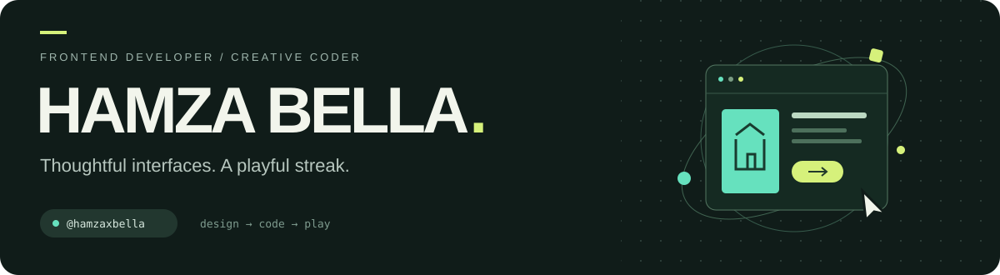

### Salam, I'm Hamza 👋

I build websites that make complex content feel simple — and small browser experiments that make simple rules feel alive.

My work moves between **React interfaces**, **Next.js + Sanity websites**, and **creative coding with Canvas**. I care about clear layouts, purposeful motion, and the details people actually notice.

  <a href="https://github.com/hamzaxbella/hamzaxbella/blob/master/PROJECTS.md"><b>Explore my work ↗</b></a>
  &nbsp; · &nbsp;
  <a href="https://github.com/hamzaxbella/hamzaxbella/issues">Let's talk</a>

---

### Selected work

<table>
<tr>
<td width="50%" valign="top">
<h3>01 / OneSmile</h3>

A multilingual dental services website with service pages, animated sections, and contact integrations.

<code>React</code> <code>Tailwind CSS</code> <code>GSAP</code>

<a href="https://one-smile.vercel.app">Visit website ↗</a> · <a href="https://github.com/hamzaxbella/OneSmile">Source</a>
</td>
<td width="50%" valign="top">
<h3>02 / Betha Architecture</h3>

A content-managed architecture portfolio with project galleries, category filtering, and motion.

<code>Next.js</code> <code>Sanity</code> <code>TypeScript</code>

<a href="https://betha-archi.vercel.app">Visit website ↗</a> · <a href="https://github.com/hamzaxbella/betha-archi">Source</a>
</td>
</tr>
<tr>
<td width="50%" valign="top">
<h3>03 / WebFundamentals</h3>

French-language lessons in HTML, CSS, JavaScript, and HTTP, with a live HTML/CSS playground.

<code>React</code> <code>TypeScript</code> <code>Vite</code>

<a href="https://devweb-lilac.vercel.app">Try the lessons ↗</a> · <a href="https://github.com/hamzaxbella/devweb">Source</a>
</td>
<td width="50%" valign="top">
<h3>04 / Inalgora Card Generator</h3>

Turn a PDF template, a cropped portrait, and a few text fields into a downloadable membership card.

<code>JavaScript</code> <code>pdf-lib</code> <code>Canvas</code>

<a href="https://github.com/hamzaxbella/inalgora-card-generator">Explore the tool ↗</a>
</td>
</tr>
</table>

### The playful side

| Experiment | What's happening? | Jump in |
| --- | --- | --- |
| **Particle Ecosystem** | Colored particles, attraction, repulsion, and surprisingly lively patterns. | [Watch](https://particles-ecosystem.vercel.app) · [Code](https://github.com/hamzaxbella/Particles_Ecosystem) |
| **BullEye Bully Bash** | A bull-themed Canvas arcade experiment. A little chaos, a lot of collision checks. | [Play](https://hamzaxbella.github.io/Bulleye-Bully-Bash/) · [Code](https://github.com/hamzaxbella/Bulleye-Bully-Bash) |

### Tools I reach for

**Interfaces** — React, Next.js, TypeScript, JavaScript, Tailwind CSS  
**Content & motion** — Sanity, GSAP, Framer Motion, Canvas 2D  
**Also exploring** — React Native and Expo

<b>A little context</b>

I started with HTML/CSS portfolio templates and small JavaScript experiments. That grew into routed React apps, CMS-driven websites, and more involved product interfaces.

The [project index](PROJECTS.md) separates selected work, smaller studies, and the learning archive. Forks keep their original attribution, and prototypes are described as prototypes.

---

Serious about the details. Occasionally distracted by 350 tiny particles.

