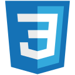

# Salam, I'm Hamza 👋

**Software Engineer · Web, mobile & AI agents**

I build web and mobile applications with TypeScript, React, and React Native. My work also covers APIs, PostgreSQL, and the background jobs behind the interface.

- 🔧 Currently working on **Associa, PeptAI, Swarms, and Zyllux**.
- 🧩 I enjoy figuring out how the interface, data, and backend fit together.
- 🎮 On the side: browser games, Canvas experiments, and probably one more animation.

P.S. [This README is multiplayer.](#one-more-game)

## Languages

  &nbsp;&nbsp;
  &nbsp;&nbsp;
  &nbsp;&nbsp;
  &nbsp;&nbsp;
  &nbsp;&nbsp;
  &nbsp;&nbsp;
  

**TypeScript · JavaScript · Python · PHP · SQL · HTML · CSS**

TypeScript and JavaScript are my main languages. I use SQL for application data, Python for tooling, and PHP in earlier web projects.

## Tech stack

Also working with **Drizzle**, **Trigger.dev**, **Tailwind CSS**, and **GSAP**.

## What I'm working on

| Project | What it does | Built with |
| --- | --- | --- |
| **[Associa](PROJECTS.md#associa)** | Association operations across a web back office and an Android field app. | Next.js · React Native · PostgreSQL |
| **[PeptAI](PROJECTS.md#peptai)** | Mobile tracking, inventory, and personal records. | Expo · TypeScript · Supabase |
| **[Swarms](PROJECTS.md#swarms)** | An agent workspace with scheduled runs and background execution. | Next.js · Trigger.dev · Drizzle |
| **[Zyllux](PROJECTS.md#zyllux)** | A multilingual studio platform with an interactive project estimator. | Next.js · next-intl · Cloudflare |

These are ongoing projects I work on and contribute to. The source is private; each project links to a short public overview.

<!-- GAME:START -->
## One more game?

One board, everyone who visits. Connect four. Leave the next move to a stranger.

**🟡 Your move.** Pick a column.

| [1 ↓](https://github.com/hamzaxbella/hamzaxbella/issues/new?title=play%7C1%7C1%7C1&body=Submit+this+issue+without+changing+the+title+to+play.+GitHub+Actions+updates+the+shared+board%2C+then+closes+the+issue.+Refresh+the+profile+after+the+workflow+finishes.+If+someone+moves+first%2C+refresh+and+choose+again.) | [2 ↓](https://github.com/hamzaxbella/hamzaxbella/issues/new?title=play%7C1%7C1%7C2&body=Submit+this+issue+without+changing+the+title+to+play.+GitHub+Actions+updates+the+shared+board%2C+then+closes+the+issue.+Refresh+the+profile+after+the+workflow+finishes.+If+someone+moves+first%2C+refresh+and+choose+again.) | [3 ↓](https://github.com/hamzaxbella/hamzaxbella/issues/new?title=play%7C1%7C1%7C3&body=Submit+this+issue+without+changing+the+title+to+play.+GitHub+Actions+updates+the+shared+board%2C+then+closes+the+issue.+Refresh+the+profile+after+the+workflow+finishes.+If+someone+moves+first%2C+refresh+and+choose+again.) | [4 ↓](https://github.com/hamzaxbella/hamzaxbella/issues/new?title=play%7C1%7C1%7C4&body=Submit+this+issue+without+changing+the+title+to+play.+GitHub+Actions+updates+the+shared+board%2C+then+closes+the+issue.+Refresh+the+profile+after+the+workflow+finishes.+If+someone+moves+first%2C+refresh+and+choose+again.) | [5 ↓](https://github.com/hamzaxbella/hamzaxbella/issues/new?title=play%7C1%7C1%7C5&body=Submit+this+issue+without+changing+the+title+to+play.+GitHub+Actions+updates+the+shared+board%2C+then+closes+the+issue.+Refresh+the+profile+after+the+workflow+finishes.+If+someone+moves+first%2C+refresh+and+choose+again.) | [6 ↓](https://github.com/hamzaxbella/hamzaxbella/issues/new?title=play%7C1%7C1%7C6&body=Submit+this+issue+without+changing+the+title+to+play.+GitHub+Actions+updates+the+shared+board%2C+then+closes+the+issue.+Refresh+the+profile+after+the+workflow+finishes.+If+someone+moves+first%2C+refresh+and+choose+again.) | [7 ↓](https://github.com/hamzaxbella/hamzaxbella/issues/new?title=play%7C1%7C1%7C7&body=Submit+this+issue+without+changing+the+title+to+play.+GitHub+Actions+updates+the+shared+board%2C+then+closes+the+issue.+Refresh+the+profile+after+the+workflow+finishes.+If+someone+moves+first%2C+refresh+and+choose+again.) |
| :---: | :---: | :---: | :---: | :---: | :---: | :---: |
| ⚪ | ⚪ | ⚪ | ⚪ | ⚪ | ⚪ | ⚪ |
| ⚪ | ⚪ | ⚪ | ⚪ | ⚪ | ⚪ | ⚪ |
| ⚪ | ⚪ | ⚪ | ⚪ | ⚪ | ⚪ | ⚪ |
| ⚪ | ⚪ | ⚪ | ⚪ | ⚪ | ⚪ | ⚪ |
| ⚪ | ⚪ | ⚪ | ⚪ | ⚪ | ⚪ | ⚪ |
| ⚪ | ⚪ | ⚪ | 🔴 | ⚪ | ⚪ | ⚪ |

Game 1 · 1 moves · Last move: hamzaxbella, column 4

Click a number → submit the prefilled issue → refresh after the workflow finishes. GitHub sign-in required. [Rules & how it works](game/README.md).
<!-- GAME:END -->

## Away from the main projects

I also make small things just to see how they work — including a [particle simulation](https://github.com/hamzaxbella/Particles_Ecosystem) and a [Canvas arcade game](https://github.com/hamzaxbella/Bulleye-Bully-Bash).

---

[Project notes](PROJECTS.md) · [Public repositories](https://github.com/hamzaxbella?tab=repositories&type=public)

Adapted from the <a href="https://github.com/yerdaulet-damir/awesome-github-readme/blob/main/templates/01-minimal.md">Minimal Profile Template</a>. <a href="CREDITS.md">Credits</a>.

