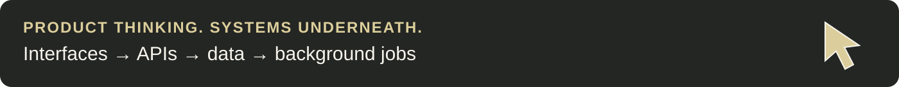
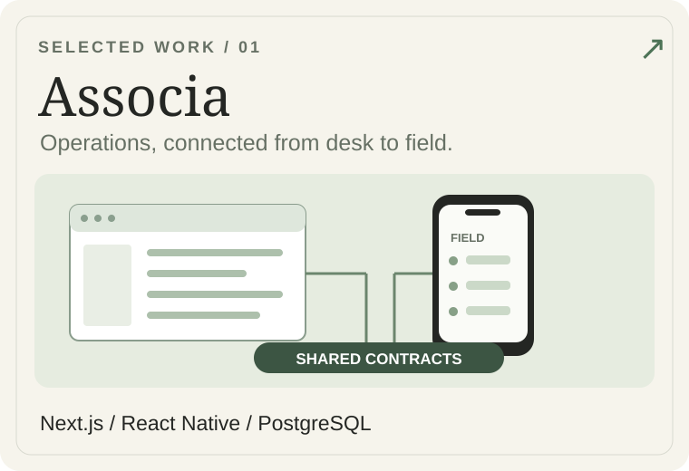
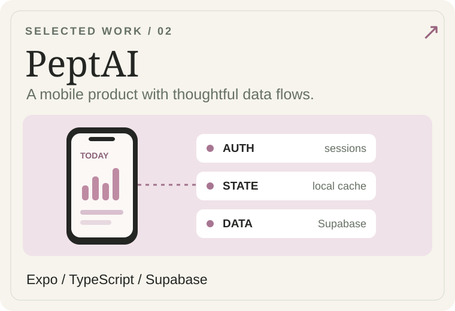
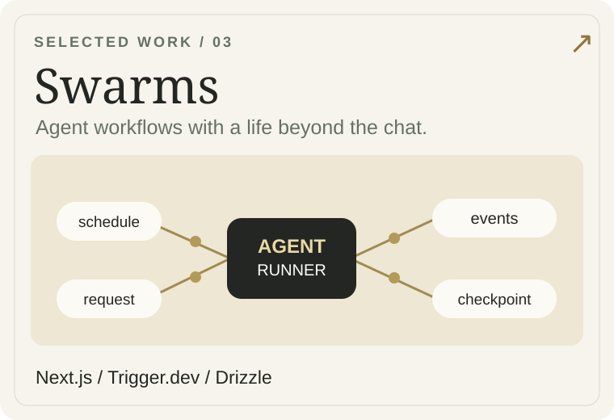
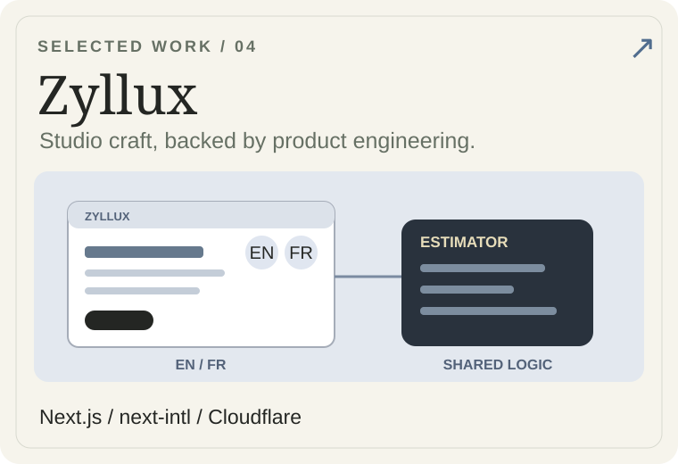
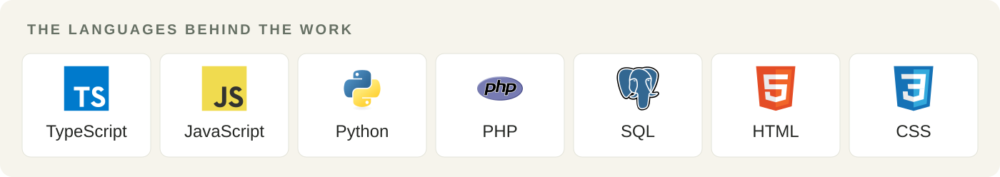

### Salam, I'm Hamza.

**Software engineer building web products, mobile apps, and agent workflows.**

I work across the interface, API, and data layers: connecting an Android app to a back office, giving an agent a background runtime, or making a complex product feel simple to use. I care about clear contracts, useful abstractions, and the last little interaction that makes an interface feel right.

[Selected engineering work ↓](#selected-engineering-work) · [Languages & tools ↓](#languages--tools) · [Project notes ↗](PROJECTS.md)

### Selected engineering work

Four projects I'm working on and contributing to. Their source repositories are private; the engineering notes below give a public overview.

<table>
<tr>
<td width="50%" valign="top">

<strong>Associa</strong> · Association operations across web and Android, with shared API contracts and a PostgreSQL data layer.  
<a href="PROJECTS.md#associa">Read the engineering notes ↗</a>
</td>
<td width="50%" valign="top">

<strong>PeptAI</strong> · Mobile product work spanning authentication, tracking flows, state management, and Supabase-backed data.  
<a href="PROJECTS.md#peptai">Read the engineering notes ↗</a>
</td>
</tr>
<tr>
<td width="50%" valign="top">

<strong>Swarms</strong> · An agent workspace with scheduled runs, a separate execution runtime, and persisted progress.  
<a href="PROJECTS.md#swarms">Read the engineering notes ↗</a>
</td>
<td width="50%" valign="top">

<strong>Zyllux</strong> · A multilingual studio platform combining motion, an adaptive project estimator, and form workflows.  
<a href="PROJECTS.md#zyllux">Read the engineering notes ↗</a>
</td>
</tr>
</table>

Original conceptual engineering illustrations; not application screenshots.

### Languages & tools

**TypeScript & JavaScript** power most of my current product work. I also use **SQL** for relational data, **Python** for tooling, and **PHP** in earlier web projects, alongside **HTML & CSS**.

| Web & mobile | Data & backend | Workflows & craft |
| :--- | :--- | :--- |
| React · Next.js | Node.js · PostgreSQL | Trigger.dev · Git |
| React Native · Expo | Drizzle · Supabase | Cloudflare Workers · Docker |
| Tailwind CSS · next-intl | Shared API contracts | GSAP · Canvas |

### A little personality, too

I like software with a thoughtful interior and a playful surface. Sometimes that means a carefully choreographed interface. Sometimes it means spending far too long watching [tiny particles attract and repel each other](https://github.com/hamzaxbella/Particles_Ecosystem).

Built with curiosity, a preference for clear systems, and the occasional “one more small tweak.”
